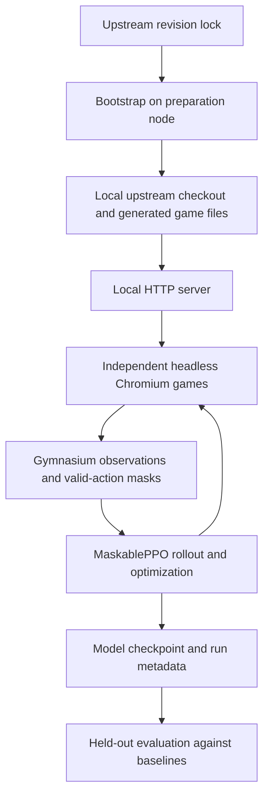

# Full-game project pipeline

[README](../README.md) · [Cluster commands](jean-zay.md) · [Training logs](training-logs.md)

## From source to an evaluated policy



All commands in these guides run from the repository root.

## 1. Prepare the game once

[`scripts/bootstrap.py`](../scripts/bootstrap.py) reads `upstream.lock.json`.
If `upstream/` is absent, it clones the repository and checks out the pinned
revision on the `rl-arena` branch. If upstream already exists, it checks the
revision and refuses a mismatch rather than updating it automatically.

It compares selected arena source modules with their committed contents, bundles
them into `rl/upstream-source.js`, then calls `scripts/build_full_game.py`.
The latter creates `full_game/index.html`, `main.js` and `game.js` from upstream.
It disables the service worker, substitutes local configuration, establishes a
local-only content security policy and exposes a training tick in the generated
game adapter. Original files inside `upstream/` are not rewritten.

Bootstrap needs the Git executable. Network access is needed for the initial
clone, not for an already-present pinned checkout. It is preparation work, not
part of each Slurm job. Rerun it when the lock, build/bootstrap code or relevant
source inputs change, or generated files are missing. A plain Git pull does not
necessarily require a rebuild if none of those inputs changed.

The JSON printed by bootstrap contains the upstream revision and the SHA-256 of
`rl/upstream-source.js`. That hash covers the arena bundle, not every full-game
asset. The trainer separately records hashes of selected training sources.

## 2. Start independent game environments

[`training/full_game_env.py`](../training/full_game_env.py) starts a localhost
HTTP server and exposes the game as a Gymnasium environment. Each worker owns a
headless Chromium instance. Reset creates a fresh browser context and guest run,
clearing progression and game state between episodes.

The browser blocks external requests and image/font/media loading during training.
Animation rendering is disabled, and the adapter supplies a seeded random stream
and simulated clock. Training advances the original game update loop directly;
it does not wait for real-time animation or capture screenshots.

A movement action runs up to six ticks at 60 Hz, normally 0.1 simulated seconds.
A pending choice, death or horizon can stop that advance early. Menu actions
resolve callbacks without advancing the game clock. The smoke test checks exact
replay for a fixed seed and action sequence; it does not prove reproducibility
across arbitrary software versions or hardware changes.

## 3. Observations, actions and reward

[`full_game/training.js`](../full_game/training.js) constructs the structured
observation, valid-action mask, reward and episode metrics. The current vector
contains 2,366 values; Python derives its shape from the initial observation.
It includes player state, nearby enemies/projectiles/pickups, local terrain and
hazards, world objects, equipped moves/items and the contents of pending choices.
Nearby entity lists are bounded, so this remains a partially observed task.

| Action | Meaning |
| --- | --- |
| 0–8 | Keep the active move and choose one of nine movement directions, including idle |
| 9–44 | Select active slot 1–4 and choose a movement direction |
| 45–48 | Select a visible upgrade, item or fusion option |
| 49 | Reroll an available level-up choice |

The mask disables unavailable slots, options and rerolls. During a menu event,
movement is masked out. A fusion can require two successive choices. Reaching
chests, springs and other world objects happens through ordinary movement and
the game's interaction logic. There is one joint policy, not separate movement
and strategy agents.

Each step receives:

```text
reward = 0.1 × additional survival seconds
       + 0.1 × XP gained
       + 0.5 × kills gained
       − 0.1 × HP lost to damage
       − 10 if death occurs on this step
```

`damage` measures damage taken, not damage dealt. Reward is accumulated over an
episode to produce its return. A high return can reflect XP or kills as well as
survival, so compare the separate metrics when judging behavior.

Death/game over terminates an episode. Reaching the configured simulated duration
truncates it. A decision-count cap of `ceil(duration × 10) + 1000` also truncates
runs, preventing unlimited decisions without game-time progress.

## 4. Collect experience and train PPO

[`training/train_full_game.py`](../training/train_full_game.py) uses
`SubprocVecEnv` to run independent environments in separate processes. Defaults:

| Setting | Value |
| --- | --- |
| Parallel games | 4 |
| Rollout steps per game | 128 |
| Transitions per rollout | 512 |
| Optimization epochs per rollout | 4 |
| Minibatch size | 64 |
| Learning rate | 0.0003 |
| Network hidden layers | 256, 256 |
| Requested transitions | 100,000 |
| Episode horizon | 120 simulated seconds |
| Pokémon / initial training seed | dex 7 (Squirtle) / 123 |

The games keep running across rollout boundaries. When one episode ends, that
worker resets automatically; the other games continue. After collecting a full
rollout, PPO updates the network and then collects more experience with the
updated policy. The GPU handles network computation, while Chromium simulation
and process communication consume CPU resources. More environments or a larger
GPU do not automatically improve throughput.

The trainer checks the upstream revision by reading `.git` metadata directly.
The Git executable is not required, but the metadata must remain accessible.
This revision check is not a complete audit for uncommitted upstream changes.

Requested steps may round up to a complete rollout. A wall-time callback can stop
earlier and save the model. The cluster sets this learning budget to 6,000 seconds;
it starts after environment initialization and is checked during rollouts, so
leave room in the Slurm allocation for setup, optimization and saving.

## 5. Save enough context to interpret the result

| Artifact | Purpose |
| --- | --- |
| `model.zip` | Final policy checkpoint, including model training state |
| `run.json` | Arguments, source pin, package versions, GPU, selected source hashes, timing and completed transitions |
| `env-*.monitor.csv` | Per-worker completed episode returns, lengths and gameplay metrics |
| `checkpoints/full_*_steps.zip` | Intermediate checkpoints, approximately every 10,000 transitions |
| `evaluation-<jobid>.json` | Cluster evaluation means and individual episodes |

Keep `run.json` beside `model.zip`: evaluation reads it to recover the duration
and Pokémon. Most files under `results/` are ignored by Git; explicitly retain
or transfer experiments you want to keep.

`--resume` continues a compatible full-game checkpoint into a new output directory.
It preserves model/optimizer state but does not restore live environments,
mid-episode trajectories or exact environment RNG state. The common Slurm script
does not expose a resume option; use a dedicated batch script invoking the Python
CLI if continuation is needed. Arena and vision checkpoints are incompatible.

## 6. Evaluate on held-out episodes

[`training/evaluate_full_game.py`](../training/evaluate_full_game.py) uses
seeds starting at 1,000,000,000. Automatic training resets draw seeds below that
range. Evaluation uses deterministic masked PPO predictions and CPU inference,
with the saved run's horizon and Pokémon.

With `--baselines`, each policy sees the same seeds:

| Policy key | Behavior |
| --- | --- |
| `ppo` | Learned policy |
| `stand_first` | Stand still and choose the first valid menu option |
| `circle_first` | Cycle movement directions and choose the first valid menu option |
| `random_valid` | Randomly choose among valid actions |

The cluster default is 20 episodes per policy: 80 episodes with all baselines.
Compare survival, death fraction, XP, damage taken, return and choice counts.
Individual results are under `policies.<name>.runs`; averages are under `mean`.
A `dead` mean of 0.25 means 25% of evaluated episodes ended in death/game over.
Truncation is reported per episode and can indicate the horizon or decision cap.

The full-game evaluator reports results but does not implement the older arena's
confidence-bound promotion gate. A smoke pass means the workflow runs; a useful
agent should consistently improve on baselines on held-out seeds. Check that
reward improvements also correspond to the gameplay behavior you want.

## Other workflows in this repository

The playable local game retains rendering and local accounts. Full-game training
uses the same underlying game with a dedicated simulation adapter and fresh guests.
The older arena replaces world/spawn/menu logic with a controlled task and has
397 observations and nine movement actions. Its vision student learns from
screenshots of that arena, not the full game. See [arena and vision](arena-and-vision.md).
